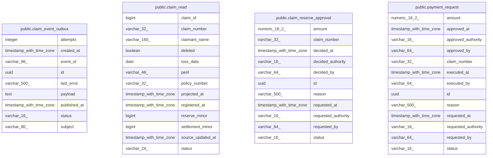

# claims

## Tables

| Name                                                              | Columns | Comment | Type       |
| ----------------------------------------------------------------- | ------- | ------- | ---------- |
| [public.claim_event_outbox](public.claim_event_outbox.md)         | 9       |         | BASE TABLE |
| [public.claim_read](public.claim_read.md)                         | 13      |         | BASE TABLE |
| [public.claim_reserve_approval](public.claim_reserve_approval.md) | 11      |         | BASE TABLE |
| [public.payment_request](public.payment_request.md)               | 13      |         | BASE TABLE |

## Relations

---

> Generated by [tbls](https://github.com/k1LoW/tbls)
