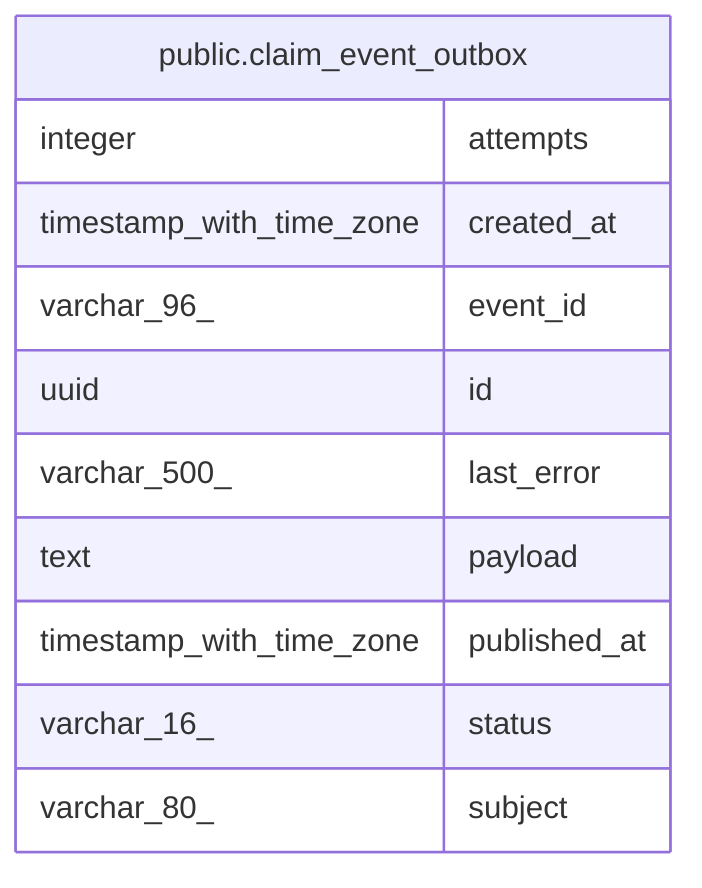

# public.claim_event_outbox

## Columns

| Name         | Type                     | Default                      | Nullable | Children | Parents | Comment |
| ------------ | ------------------------ | ---------------------------- | -------- | -------- | ------- | ------- |
| attempts     | integer                  | 0                            | false    |          |         |         |
| created_at   | timestamp with time zone | now()                        | false    |          |         |         |
| event_id     | varchar(96)              |                              | false    |          |         |         |
| id           | uuid                     |                              | false    |          |         |         |
| last_error   | varchar(500)             |                              | true     |          |         |         |
| payload      | text                     |                              | false    |          |         |         |
| published_at | timestamp with time zone |                              | true     |          |         |         |
| status       | varchar(16)              | 'pending'::character varying | false    |          |         |         |
| subject      | varchar(80)              |                              | false    |          |         |         |

## Constraints

| Name                            | Type        | Definition        |
| ------------------------------- | ----------- | ----------------- |
| claim_event_outbox_event_id_key | UNIQUE      | UNIQUE (event_id) |
| claim_event_outbox_pkey         | PRIMARY KEY | PRIMARY KEY (id)  |

## Indexes

| Name                            | Definition                                                                                                                             |
| ------------------------------- | -------------------------------------------------------------------------------------------------------------------------------------- |
| claim_event_outbox_event_id_key | CREATE UNIQUE INDEX claim_event_outbox_event_id_key ON public.claim_event_outbox USING btree (event_id)                                |
| claim_event_outbox_pkey         | CREATE UNIQUE INDEX claim_event_outbox_pkey ON public.claim_event_outbox USING btree (id)                                              |
| idx_claim_event_outbox_pending  | CREATE INDEX idx_claim_event_outbox_pending ON public.claim_event_outbox USING btree (status) WHERE ((status)::text = 'pending'::text) |

## Relations

---

> Generated by [tbls](https://github.com/k1LoW/tbls)
