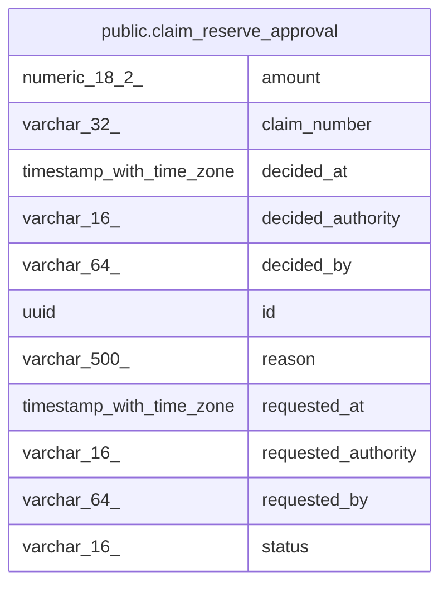

# public.claim_reserve_approval

## Columns

| Name                | Type                     | Default                      | Nullable | Children | Parents | Comment |
| ------------------- | ------------------------ | ---------------------------- | -------- | -------- | ------- | ------- |
| amount              | numeric(18,2)            |                              | false    |          |         |         |
| claim_number        | varchar(32)              |                              | false    |          |         |         |
| decided_at          | timestamp with time zone |                              | true     |          |         |         |
| decided_authority   | varchar(16)              |                              | true     |          |         |         |
| decided_by          | varchar(64)              |                              | true     |          |         |         |
| id                  | uuid                     |                              | false    |          |         |         |
| reason              | varchar(500)             |                              | true     |          |         |         |
| requested_at        | timestamp with time zone | now()                        | false    |          |         |         |
| requested_authority | varchar(16)              |                              | false    |          |         |         |
| requested_by        | varchar(64)              |                              | false    |          |         |         |
| status              | varchar(16)              | 'pending'::character varying | false    |          |         |         |

## Constraints

| Name                                | Type        | Definition                      |
| ----------------------------------- | ----------- | ------------------------------- |
| claim_reserve_approval_amount_check | CHECK       | CHECK ((amount > (0)::numeric)) |
| claim_reserve_approval_pkey         | PRIMARY KEY | PRIMARY KEY (id)                |

## Indexes

| Name                         | Definition                                                                                                                               |
| ---------------------------- | ---------------------------------------------------------------------------------------------------------------------------------------- |
| claim_reserve_approval_pkey  | CREATE UNIQUE INDEX claim_reserve_approval_pkey ON public.claim_reserve_approval USING btree (id)                                        |
| idx_reserve_approval_claim   | CREATE INDEX idx_reserve_approval_claim ON public.claim_reserve_approval USING btree (claim_number)                                      |
| idx_reserve_approval_pending | CREATE INDEX idx_reserve_approval_pending ON public.claim_reserve_approval USING btree (status) WHERE ((status)::text = 'pending'::text) |

## Relations

---

> Generated by [tbls](https://github.com/k1LoW/tbls)
