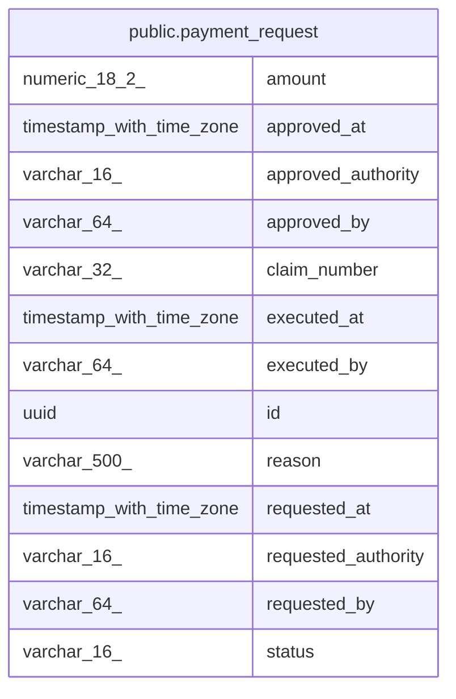

# public.payment_request

## Columns

| Name                | Type                     | Default                        | Nullable | Children | Parents | Comment |
| ------------------- | ------------------------ | ------------------------------ | -------- | -------- | ------- | ------- |
| amount              | numeric(18,2)            |                                | false    |          |         |         |
| approved_at         | timestamp with time zone |                                | true     |          |         |         |
| approved_authority  | varchar(16)              |                                | true     |          |         |         |
| approved_by         | varchar(64)              |                                | true     |          |         |         |
| claim_number        | varchar(32)              |                                | false    |          |         |         |
| executed_at         | timestamp with time zone |                                | true     |          |         |         |
| executed_by         | varchar(64)              |                                | true     |          |         |         |
| id                  | uuid                     |                                | false    |          |         |         |
| reason              | varchar(500)             |                                | true     |          |         |         |
| requested_at        | timestamp with time zone | now()                          | false    |          |         |         |
| requested_authority | varchar(16)              |                                | false    |          |         |         |
| requested_by        | varchar(64)              |                                | false    |          |         |         |
| status              | varchar(16)              | 'requested'::character varying | false    |          |         |         |

## Constraints

| Name                         | Type        | Definition                      |
| ---------------------------- | ----------- | ------------------------------- |
| payment_request_amount_check | CHECK       | CHECK ((amount > (0)::numeric)) |
| payment_request_pkey         | PRIMARY KEY | PRIMARY KEY (id)                |

## Indexes

| Name                      | Definition                                                                                                                                                                                         |
| ------------------------- | -------------------------------------------------------------------------------------------------------------------------------------------------------------------------------------------------- |
| idx_payment_request_claim | CREATE INDEX idx_payment_request_claim ON public.payment_request USING btree (claim_number)                                                                                                        |
| idx_payment_request_open  | CREATE INDEX idx_payment_request_open ON public.payment_request USING btree (status) WHERE ((status)::text = ANY ((ARRAY['requested'::character varying, 'approved'::character varying])::text[])) |
| payment_request_pkey      | CREATE UNIQUE INDEX payment_request_pkey ON public.payment_request USING btree (id)                                                                                                                |

## Relations

---

> Generated by [tbls](https://github.com/k1LoW/tbls)
